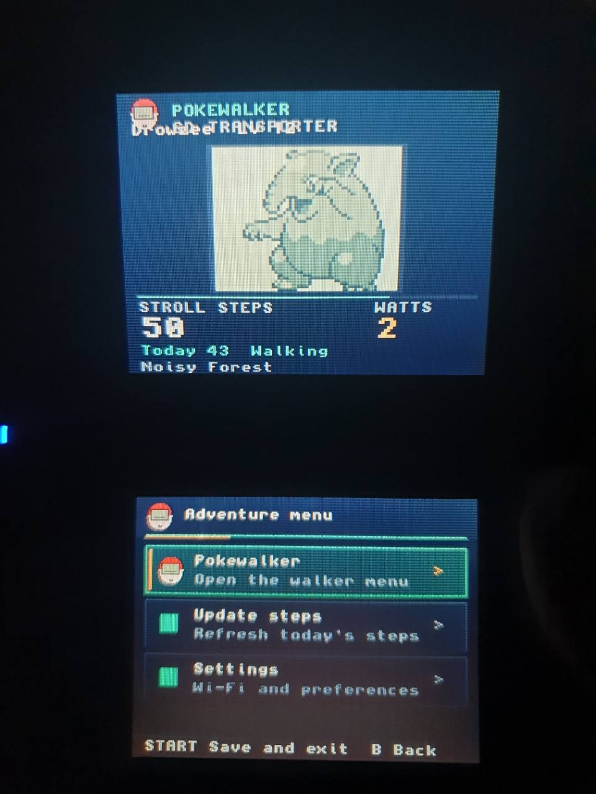
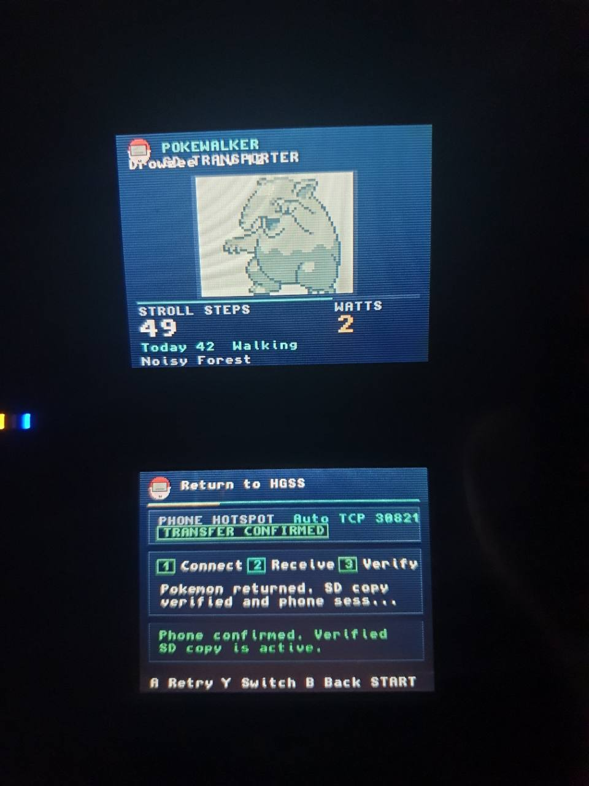
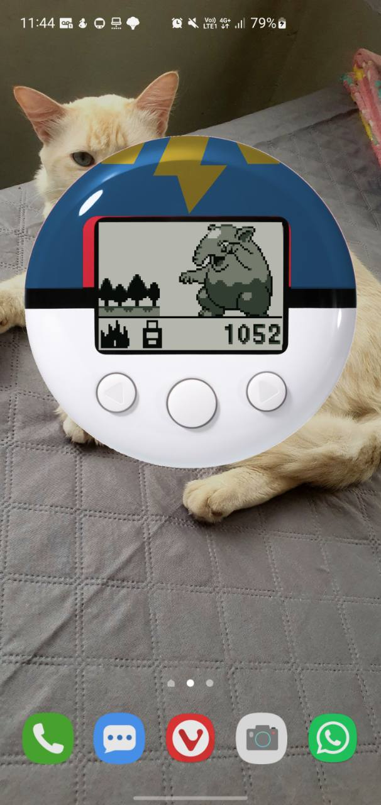

# Pokéwalker Virtual — beta 2 (27/11/2026)

Esta revisão completa o pacote beta com o **bootstrap modificado**. O fluxo desta versão é: HGSS conversa com o Pokéwalker virtual pelo caminho de infravermelho emulado pelo bootstrap; o bootstrap mantém o arquivo `.walker` do save; o homebrew companheiro lê esse arquivo e o sincroniza com o app Android por Wi‑Fi local.

> O jogo não abre uma conexão TCP com o telefone. Para a transferência do telefone, use também o homebrew companheiro `.nds`.

## Downloads

- [Pacote completo (ZIP)](https://github.com/LittleCherryyy/PokeWalkerForkSDTRANSPORTER/releases/download/pokewalker-v40-beta.2/Pokewalker-Virtual-v40-beta.2.zip)
- [APK Android v40 (debug)](https://github.com/LittleCherryyy/PokeWalkerForkSDTRANSPORTER/releases/download/pokewalker-v40-beta.2/Pokewalker-Android-v40-debug.apk)
- [Homebrew companheiro DS/DSi](https://github.com/LittleCherryyy/PokeWalkerForkSDTRANSPORTER/releases/download/pokewalker-v40-beta.2/Pokewalker-SD-Transporter-NDS-20261127.nds)
- [Bootstrap modificado nds-bootstrap Nightly](https://github.com/LittleCherryyy/PokeWalkerForkSDTRANSPORTER/releases/download/pokewalker-v40-beta.2/nds-bootstrap-nightly.nds)
- [Hashes SHA-256](https://github.com/LittleCherryyy/PokeWalkerForkSDTRANSPORTER/releases/download/pokewalker-v40-beta.2/SHA256SUMS-release.txt)
- [Pacote Virtual Slot-2 NBP016 + TWLM03](https://github.com/LittleCherryyy/PokeWalkerForkSDTRANSPORTER/releases/tag/virtual-slot2-v0.1.0-beta)

O ZIP contém os três binários, guia de uso, hashes, atribuição/licença e capturas reais do DSi e do widget. Não inclui ROMs, saves, dumps de firmware ou dados pessoais.

## Funções incluídas

### Bootstrap e jogo HGSS

- O bootstrap modificado inicia HeartGold/SoulSilver com o Pokéwalker virtual e mantém um arquivo EEPROM `.walker` distinto para cada save HGSS.
- O jogador continua usando o menu normal do HGSS para enviar um Pokémon ao Pokéwalker virtual. A emulação atende à comunicação de infravermelho do jogo e grava os dados no `.walker` do save. O bootstrap não envia esse Pokémon diretamente ao app pela rede.
- A integração do bootstrap também contém o emulador de Slot-2 virtual do projeto. O caminho de migração GBA → jogos da geração IV usa a configuração/menu modificado de TWiLight Menu++ e o fluxo normal de migração do jogo. Veja a seção “Virtual Slot-2” abaixo: seu pacote NBP016 + TWLM03 é uma instalação própria e não deve ter arquivos de bootstrap misturados sem conferir qual variante está ativa.
- O bootstrap inclui salvaguardas de leitura/gravação e recuperação do `.walker` descritas na documentação de build. Essas proteções não substituem cópias independentes do save e do SD.

### App Android e widget

- Perfis separados com passos, watts, parceiro, Pokémon, itens e estado próprio.
- Menus clássicos do Pokéwalker no app e no widget; esquerda/direita navegam e o botão central seleciona. Toque no LCD retorna imediatamente à tela inicial do Pokéwalker.
- As skins disponíveis permanecem sincronizadas: mudar a skin no app atualiza o widget e vice-versa.
- `Connect → Console` no app ou no widget inicia a escuta em segundo plano e mantém o estado visível pela notificação do Android.
- O perfil determina a direção: perfil sem Pokémon fica pronto para receber do homebrew; perfil que contém o Pokémon arma a devolução ao HGSS.
- A sessão fecha após confirmação da transferência. Sair da tela de sincronização ou tocar no LCD enquanto aguarda também desarma a escuta.

### Homebrew companheiro `.nds`

- Localiza e abre o `.walker` gerado para o save HGSS; mantém a associação do mesmo arquivo durante envio e retorno.
- Permite navegar nos menus do Pokéwalker e mostra estados de espera, conexão, transferência, validação, confirmação e falha.
- Conecta o DSi/DS ao telefone na rede local e transfere nos dois sentidos, com confirmação e verificações da sessão. A posse do Pokémon no telefone mantém o `.walker` bloqueado para evitar que outro save seja usado por engano.
- A sessão de retorno usa o mesmo perfil e o mesmo `.walker`; progresso só é removido do telefone depois da confirmação do console.

### Conexão Android ↔ DSi

- O celular escuta em TCP `30821`; é o DS/DSi que inicia a conexão. Ambos ficam no mesmo hotspot/rede local de 2,4 GHz. Não é necessário internet, pareamento Bluetooth ou digitar IP.
- A direção é escolhida pelo estado do perfil; a conexão de rede por si só não confirma uma transferência.
- Bluetooth para conectar dois telefones é um recurso separado e não é usado neste caminho de sync do DSi.

## Instalação e uso: HGSS → app

1. Faça cópia do save HGSS, do `.walker` existente e do cartão SD. Não teste com a única cópia.
2. Instale o APK v40 como atualização do app existente. Abra o app, escolha o perfil que corresponde ao save HGSS e associe esse perfil ao widget, se for usá-lo. Não desinstale o app para resolver conflito de assinatura: isso pode apagar os dados locais.
3. Copie `nds-bootstrap-nightly.nds` do pacote para `SD:/_nds/nds-bootstrap-nightly.nds`, guardando antes uma cópia do bootstrap atual. No TWiLight Menu++, selecione **Nightly** para a inicialização de HGSS e habilite **Virtual Pokéwalker** nas opções do jogo (menu **Y**, no build de menu compatível).
4. Conecte o telefone e o DSi ao mesmo hotspot local de 2,4 GHz. No homebrew companheiro, configure/seleciona a rede em **Settings → Wi‑Fi setup**.
5. Inicie HGSS e envie o Pokémon ao Pokéwalker virtual pelo menu normal do jogo. Aguarde a tela de conclusão e o save. Isso cria ou atualiza o `.walker` correspondente ao save.
6. Inicie `Pokewalker-SD-Transporter-NDS-20261127.nds`. Selecione o `.walker` daquele save. No perfil correspondente e vazio, abra **Connect → Console** no app ou navegue até essa opção pelo widget.
7. No homebrew, abra **Connect → Console** para iniciar a sessão. O primeiro lado pode aguardar; mantenha o mesmo perfil, arquivo e hotspot nos dois lados.
8. Aguarde a confirmação de gravação no app e no DSi. A indicação de TCP aceito sozinha não prova que o Pokémon foi salvo.

## Devolver do app para HGSS

1. Use o mesmo perfil Android e o mesmo `.walker` associado ao envio original.
2. Com o Pokémon no perfil, escolha **Connect → Console** no app ou widget; o app arma a direção **Return to HGSS**.
3. No homebrew, selecione o walker bloqueado pela sessão e inicie **Connect → Console** (ou a ação **Return** indicada na tela do walker, se estiver disponível).
4. Espere o homebrew gravar e verificar o `.walker` e confirmar a sessão. Depois, volte ao HGSS e conclua a recuperação do Pokémon pelo fluxo normal do jogo.

Se a sessão for interrompida, retome pelo mesmo perfil e pelo mesmo `.walker`; não exclua nem force o desbloqueio dos arquivos de recuperação enquanto houver um retorno pendente.

## Virtual Slot-2

O projeto também fornece migração de um save GBA virtual para Pal Park em jogos compatíveis da geração IV. Se já usa o pacote testado **Virtual Slot-2 v0.1.0-beta (NBP016 + TWLM03)**, siga o README desse pacote e mantenha o conjunto de menu/plugin/bootstrap que ele fornece. Ele é uma instalação separada, sem app Android ou Wi‑Fi. Não copie o bootstrap dessa variante sobre o bootstrap deste beta sem trocar para o conjunto correspondente; os dois pacotes fornecem builds Nightly diferentes.

O source tree deste beta contém o emulador de Slot-2 no bootstrap e a integração do menu de seleção. A release independente NBP016 + TWLM03 continua sendo o caminho de instalação já empacotado e confirmado em hardware; não afirmamos que a mistura dos dois pacotes no mesmo SD foi validada.

## O que este fork acrescenta ao SD Transporter original

O [SD Transporter original](https://github.com/Shinygati/SD-Transporter) já fornece a base do Pokéwalker virtual e dos cartuchos virtuais; os autores, código e licenças upstream são preservados. Esta beta combina essa base com as seguintes adições e ajustes do fork:

- fluxo local Android ↔ companion DS/DSi com porta fixa `30821`, conexão iniciada pelo console e sem IP manual;
- envio e retorno ligados ao perfil Android e à sessão/arquivo `.walker` de origem, com bloqueio, verificações e confirmação antes de mudar a posse do Pokémon;
- app Android v40 e widget com navegação dos menus, skin compartilhada, início do sync e fechamento/desarme da sessão;
- estados de rede e de transferência visíveis no app/widget e no homebrew, para distinguir espera, tentativa, conclusão e falha;
- pacote do bootstrap modificado junto do APK e do homebrew, documentando a etapa que gera/atualiza o `.walker` antes da transferência Wi‑Fi.

Não reivindicamos como novos os jogos, dados de Pokéwalker, mecânicas nativas de Pal Park nem as funções já existentes no upstream. Visitas/batalhas entre walkers e transferência TCP residente direta de dentro do HGSS ficam fora do escopo validado desta beta. O APK é debug; não é um lançamento da Play Store.

## Capturas reais

## Segurança e limites

- Confirme os hashes do arquivo baixado e guarde cópias de `.sav`, `.walker` e do bootstrap anterior.
- O fluxo publicado de transferência é **HGSS → `.walker` no SD → homebrew `.nds` → TCP local → app** e o retorno no sentido inverso. Não é uma conexão de rede iniciada diretamente pelo jogo.
- O bootstrap contém trabalho experimental de conexão residente; isso não é necessário para o caminho com o homebrew companheiro e não está declarado como transferência direta funcional.
- Hotspots, modos de segurança, cartões SD, launchers e modelos de console podem variar. Use uma rede local compatível com o DS/DSi.
- O comportamento de Bluetooth entre telefones é separado; ele não participa deste sync.

