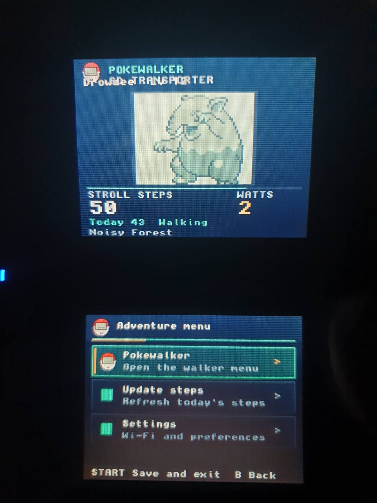
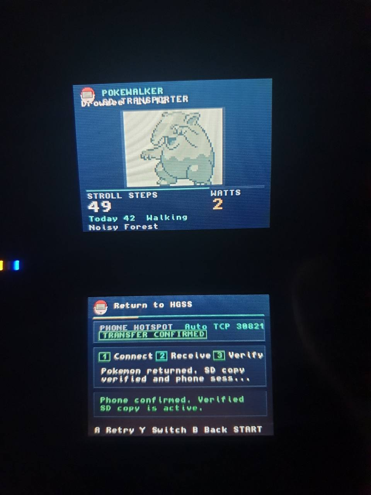
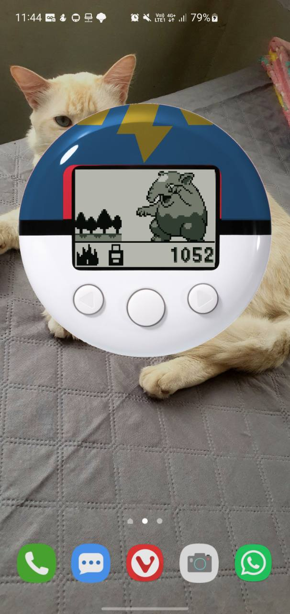

# Pokéwalker Virtual — beta 1 (27/11/2026)

Este pacote reúne o **APK Android v40** e o **homebrew companheiro para DS/DSi**. É um beta para a sincronização local entre o perfil Android e o arquivo `.walker` do SD Transporter.

## Arquivos

- `Pokewalker-Android-v40-debug.apk` — `versionCode 40`, `1.11.1-v40-auto-close-sync-fit-text`. APK de depuração, não assinado para publicação na Play Store.
- `Pokewalker-SD-Transporter-NDS-20261127.nds` — homebrew companheiro atualizado em 27/11/2026.
- `SHA256SUMS.txt` — hashes para conferir os downloads.

O pacote **não** inclui ROM de Pokémon, saves, firmware de console nem nds-bootstrap. Faça backup do save HGSS e do SD antes de transferir. Este pacote não substitui nem altera o módulo Virtual Slot-2; ele continua separado.

## O que já funciona neste beta

### Aplicativo Android

- Perfis separados para os Pokéwalkers; o perfil escolhido no widget determina qual dados e Pokémon aparecem nele.
- Menus clássicos do Pokéwalker, passos, watts, parceiro, Pokémon e itens.
- Skins disponíveis no app e widget sincronizadas: trocar em um atualiza o outro.
- Widget com controles do Pokéwalker: esquerda/direita navegam, centro seleciona; tocar no LCD volta ao menu inicial do Pokéwalker.
- **Connect → Console** no app ou no widget inicia o receptor em segundo plano. O widget pode iniciar e manter a escuta sem abrir a tela principal do app. O Android mostra uma notificação enquanto a sessão está ativa.
- O app escolhe a direção pelo estado do perfil: perfil sem Pokémon arma o recebimento do homebrew; perfil com Pokémon ou retorno pendente arma a devolução ao HGSS.
- O receptor usa TCP `30821` e não pede IP/porta manual. Fecha e desarma após a transferência confirmada; também para ao sair da tela de sync do app ou tocar no LCD do widget enquanto aguarda.

### Homebrew `.nds`

- Abre os arquivos `.walker` associados aos saves HGSS no SD, executa os menus do Pokéwalker e mantém a sessão selecionada.
- Wi-Fi é configurado no próprio homebrew; o DS/DSi inicia a conexão TCP com o celular no hotspot local.
- Envia um Pokémon do `.walker` para o perfil Android ou devolve o conteúdo do perfil ao mesmo save, com verificação e confirmação de sessão.
- Durante o checkout, o `.walker` fica bloqueado para evitar que outro save seja confundido com a sessão que está no telefone. O retorno usa essa mesma sessão e mantém recuperação local se houver interrupção.
- A tela de sync diferencia espera por autorização, conexão, transferência, verificação e falha. O homebrew só mostra sucesso após confirmação do outro lado.

## Como configurar

1. Instale o APK v40 como atualização do app existente e abra-o uma vez. Se o Android informar conflito de assinatura, **não desinstale**: isso pode apagar perfis e dados locais; envie o erro para análise.
2. Selecione ou crie o perfil correspondente ao save HGSS. Adicione o widget, se desejar, e associe-o a esse mesmo perfil. A skin também acompanha o perfil.
3. Ative um hotspot Wi-Fi local de 2,4 GHz no celular e conecte o DSi à mesma rede. Não é necessário internet. Se a autenticação da rede impedir a conexão no DSi, use um hotspot aberto compatível com seu console.
4. Copie `Pokewalker-SD-Transporter-NDS-20261127.nds` para o SD e inicie-o pelo TWiLight Menu++. Configure/seleciona a mesma rede em **Settings → Wi-Fi setup**.
5. Escolha no homebrew o arquivo `.walker` correspondente ao save HGSS que será usado. Para o retorno, reutilize o `.walker` bloqueado pela sessão original.

## Enviar do HGSS para o aplicativo

1. No HGSS, conclua o envio do Pokémon para o Pokéwalker virtual, para que o Pokémon esteja no `.walker` do save escolhido.
2. No perfil Android vazio correspondente, abra **Connect → Console** no menu do Pokéwalker, ou navegue até essa opção pelo widget. Isso arma **Send to phone** e inicia o receptor TCP `30821`.
3. No homebrew, abra o mesmo `.walker` e escolha **Connect → Console** no menu clássico do Pokéwalker. O homebrew inicia a tentativa e aguarda a aprovação do app se ele ainda não estiver armado.
4. Aguarde **Transfer confirmed** no DSi e a confirmação de Pokémon salvo no app. TCP conectado, sozinho, não significa que o Pokémon foi transferido.

## Devolver do aplicativo ao HGSS

1. Use o mesmo perfil Android que recebeu o Pokémon e o mesmo `.walker`/save que ficou bloqueado pela sessão.
2. Abra **Connect → Console** pelo app ou pelo widget. Com o Pokémon no perfil, o app arma **Return to HGSS**.
3. No homebrew, abra o walker bloqueado e inicie **Connect → Console**; a sessão direta identifica o retorno. Se já estiver na tela de walker no telefone, **Y — Return** também inicia a devolução.
4. Espere o homebrew verificar e gravar o retorno e confirmar a sessão. O app só remove o Pokémon do perfil depois dessa confirmação; então volte ao HGSS e conclua o fluxo do jogo.

Os dois lados podem ser iniciados em qualquer ordem: o primeiro fica aguardando. Eles precisam usar o mesmo hotspot, perfil e direção. Se a tentativa for interrompida, volte ao mesmo perfil e ao mesmo `.walker`, consulte o estado de sync e use **Retry**. Não force desbloqueio nem apague arquivos de recuperação enquanto houver uma sessão pendente.

## Como a conexão realmente funciona

O celular **escuta** na porta TCP `30821`; o DSi/homebrew **abre** a conexão usando a rede/hotspot compartilhado. O app não procura o DSi por Bluetooth e o usuário não digita IP. Esta sincronização usa Wi-Fi local, não Bluetooth.

A ligação é entre o app Android e o homebrew `.nds`. **Não** é uma conexão TCP direta do HGSS em execução. Para esta beta, o homebrew companheiro precisa estar instalado e ser iniciado; a transferência TCP residente dentro do HGSS/nds-bootstrap continua experimental e não foi validada como caminho de transferência de Pokémon. Não remova o `.nds` esperando que o jogo sozinho envie ou receba pela porta.

## Diferenças para o SD Transporter original

Este trabalho deriva do [SD Transporter de Shinygati e colaboradores](https://github.com/Shinygati/SD-Transporter). O projeto original já fornece a base do Pokéwalker virtual, os dados/menus e ferramentas de companion e virtual cartridge; esses créditos e licenças continuam valendo. Esta beta não reivindica essas funções originais como criação própria.

O diferencial entregue **neste pacote** é o fluxo Android ↔ homebrew: receptor do celular na porta fixa `30821`, conexão iniciada pelo DS no hotspot sem IP manual, autorização de direção pelo perfil, retorno com confirmação de sessão, estados de conexão mais claros e controles/menu/skin do Pokéwalker no widget. A integração residente de TCP no HGSS/nds-bootstrap e o módulo Virtual Slot-2 não fazem parte dos binários deste pacote; o Slot-2 permanece em seu release separado.

Consulte também a [atribuição e licenças](../../ATTRIBUTION.md) e a [release separada do Virtual Slot-2](https://github.com/LittleCherryyy/PokeWalkerForkSDTRANSPORTER/releases/tag/virtual-slot2-v0.1.0-beta).

## Capturas do seu hardware

As imagens abaixo são capturas reais fornecidas pelo autor do projeto, não mockups. Elas ilustram o menu do homebrew, a confirmação de retorno e o widget Android.

## Limites deste beta

- Beta para Android + DSi/DS com o homebrew companheiro; comportamento pode variar por console, hotspot e launcher de widgets.
- Não inclui ROM, firmware proprietário ou dados de save.
- Bluetooth para outro celular é um fluxo separado e não é o transporte desta sincronização.
- Não inclui nem valida transferência TCP direta a partir do HGSS sem o homebrew `.nds`.
- A seleção do perfil é do usuário; mantenha a correspondência do mesmo perfil com o mesmo save durante envio e retorno.
